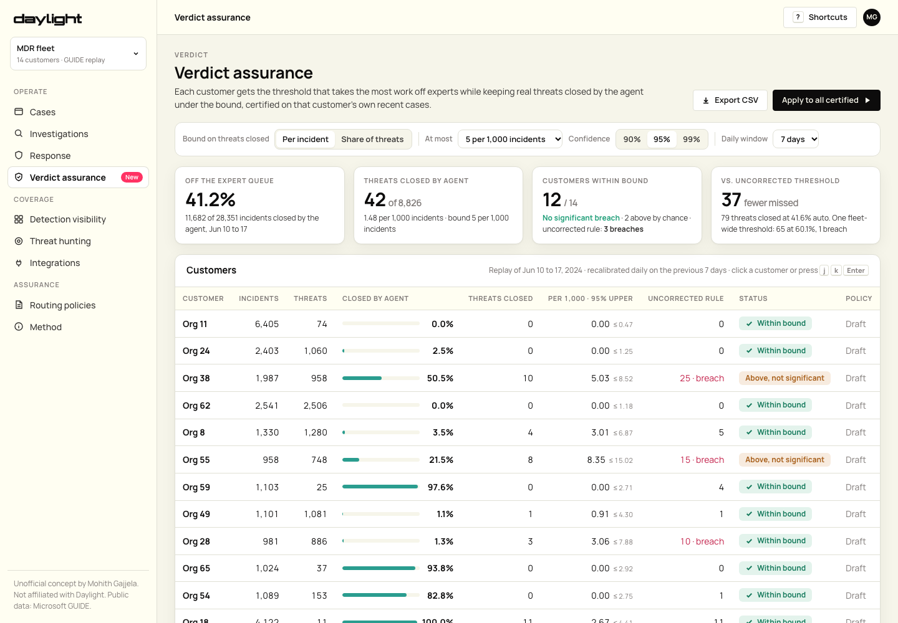

# Verdict assurance (concept for Daylight)

**Live demo:** https://mohith26.github.io/daylight-verdict-assurance/

Daylight's agents investigate every alert, and experts step in "when judgment is needed". This page answers the question that sits between them: for each customer, how much can the agent close on its own while keeping real threats closed without an expert under a stated bound, with a statistical guarantee? It certifies a per-customer routing threshold with Learn-then-Test (an exact binomial test on a pre-fixed grid, walked in fixed sequence), recalibrates every morning on that customer's last few days of cases, and keeps an auditable record of each applied policy. A guarantee is easier to put in a contract than an accuracy number, and Daylight sells "end-to-end ownership with contractual accountability".



*Unofficial concept demo by Mohith Gajjela. Not affiliated with Daylight. Public data from Microsoft GUIDE (Freitas et al., 2024).*

## Results (`data/results.json`)

Replay of **28,351 real incidents** from 14 organisations in Microsoft's public GUIDE dataset, Jun 10 to 17, 2024. Each day, every customer's threshold is recalibrated on the previous 7 days. Bound: **at most 5 real threats closed without an expert per 1,000 incidents, 95% confidence**.

| Threshold rule | Taken off the expert queue | Real threats closed by the agent | Customers significantly over the bound |
|---|---|---|---|
| **Certified per customer (this page)** | **41.2%** | **42** of 8,826 | **0 / 14** |
| Uncorrected per customer (empirical rate = bound) | 41.6% | 79 of 8,826 | 3 / 14 |
| Certified, one fleet-wide threshold | 60.1% | 65 of 8,826 | 1 / 14 |

The certified rule takes the same work off experts as the uncorrected one, with 47% fewer real threats closed and no customer significantly over its bound. A single fleet threshold auto-closes more, but one customer pays for it: customers' threat rates in this data run from under 1% to 98%. "Significantly over" uses an exact one-sided binomial test (p < 0.05). Two certified customers land slightly above the bound by chance, and the page labels them that way.

## How it works

- **AI confidence.** Each incident has a threat confidence *s*. Below a threshold λ the agent closes it; at or above, it goes to an expert. Here *s* comes from a stand-in triage model trained only on GUIDE's separate train file (empirical-Bayes encodings of detector, org × detector, alert title, category; logistic layer). Its test AUC is 0.994, and GUIDE's repeated detectors make that easy. Daylight would plug in Aura's own verdict confidence.
- **Two bounds.** *Per incident*: P(threat and closed by agent) ≤ α. *Share of threats*: P(closed by agent | threat) ≤ α.
- **Certification (Learn then Test; Angelopoulos, Bates, Candès, Jordan & Lei, 2021).** On a fixed grid of 801 thresholds chosen before seeing data, walk upward from the strictest. At each λ, test H₀: risk(λ) > α with the exact p-value P(Bin(n, α) ≤ k), where k is the number of threats below λ. Stop at the first non-rejection. Fixed-sequence testing controls the family-wise error, so with probability ≥ 1−δ the certified λ keeps the true risk ≤ α when cases are exchangeable.
- **Per customer, daily.** Each customer is certified on its own trailing window (Mondrian calibration). A customer without enough evidence gets no auto-close until it has some.
- **Audit.** Applying a policy records version, threshold, bound, confidence and window (localStorage), with export to JSON.

## The app

- **Overview** (main view): fleet KPIs; a customer table with auto-close share, threats closed, realized rate with a 95% Clopper-Pearson upper bound, the uncorrected rule's outcome, status and policy; and a per-customer dot plot of certified vs uncorrected.
- **Customer** (drill-down): score histogram with both thresholds, the certification walk (empirical rate and p-value per threshold, with the stop point), the daily thresholds, and the incident queue filtered by routing. Each incident opens in a Findings-style card.
- **Actions:** apply the certified policy (`a`), apply all, revoke, export CSV/JSON. Change the bound, α, confidence and window to see what-ifs.
- **Routing policies** (active policies and audit log) and **Method**.
- Deep links (`#customer?org=38&filter=missed`), keyboard (`j/k`, `Enter`, `g o`, `g p`, `a`, `e`, `?`, `Esc`), loading, empty and error states.

## Tests

`node --test tests/core.test.mjs` runs 14 tests. They check:
- the exact binomial CDF against direct summation, and the Clopper-Pearson inversion
- sweep counts, and that certification stops at the first failure
- that certification is never looser than the plug-in rule, and is monotone in α and δ
- a randomized simulation showing Learn-then-Test keeps the true risk under α with probability ≥ 1−δ
- a simulation showing the plug-in rule overshoots more than 3× as often
- that the rolling replay equals the sum of the daily tables
- the model's AUC
- that `results.json` is reproduced exactly with the headline numbers

GitHub Actions runs them on every push.

## Prior art and what is new

Learn-then-Test and conformal risk control are established statistics. The closest work I found is a 2026 preprint, *Dual-Threshold Conformal Deferral for Trustworthy Security Alert Triage* (Şahin & Mert; MDPI Electronics, Sep 2026). It calibrates auto-close and auto-escalate thresholds with marginal, class-conditional conformal control, pooled across datasets. This demo differs in four ways:
1. Each customer gets its own high-probability guarantee (Learn-then-Test with exact binomial tests), not one pooled marginal guarantee.
2. Thresholds recalibrate daily on a trailing window.
3. Every customer is tested for breaches on later days with an exact test, against an uncorrected rule and a fleet-wide rule, on real multi-organisation SOC labels (GUIDE).
4. Each applied threshold is kept as an auditable policy.

AI-SOC vendors (for example Torq, Intezer) auto-close alerts on confidence or verdict. I found none that publishes a certified per-customer bound. Daylight's pages say experts step in "when judgment is needed" and describe Aura findings carrying "a disposition, a confidence and a weight". They do not say how the expert line is drawn. One public Gartner Peer Insights review (Jul 2026) says Daylight's "AI capabilities are clearly not there yet to do everything needed". A certified line answers that worry with a number.

## Limitations

- GUIDE grades are customer SOC labels and can be wrong; incidents and titles are anonymised. `data/incidents.json` is a derived, aggregated subset of GUIDE published by Microsoft for research (see its Kaggle page for terms).
- The stand-in model is not Daylight's agent. GUIDE's per-organisation detector repetition makes it unusually strong.
- The guarantee assumes the next day's cases look like the trailing window's. Attacks shift, which is why breaches are tested and thresholds recalibrated daily. Two certified customers ended slightly above the bound by chance (not significant).
- "Closed by the agent" here means no expert review. It does not mean uninvestigated: in Daylight's model the agent still investigates and documents every case.

## Run it

```
python3 -m http.server   # open http://localhost:8000
node --test tests/core.test.mjs
```

Rebuild data: download GUIDE (linked from github.com/kdd2025anonymous/GUIDE or Kaggle "microsoft-security-incident-prediction"), then `python3 scripts/prepare_guide.py GUIDE.zip data && node scripts/precompute.mjs`.

## References

- A. N. Angelopoulos, S. Bates, E. J. Candès, M. I. Jordan, L. Lei. *Learn then Test: Calibrating predictive algorithms to achieve risk control.* arXiv:2110.01052 (2021).
- S. Freitas et al. *AI-Driven Guided Response for Security Operation Centers with Microsoft Copilot for Security* (GUIDE dataset). WWW Companion 2025.
